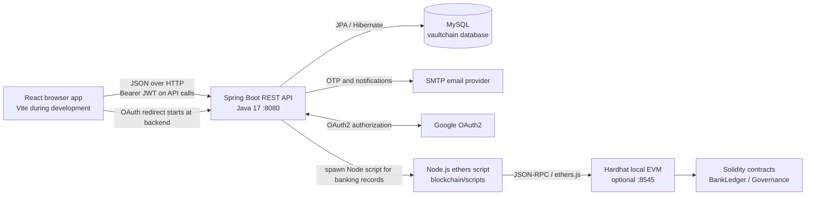
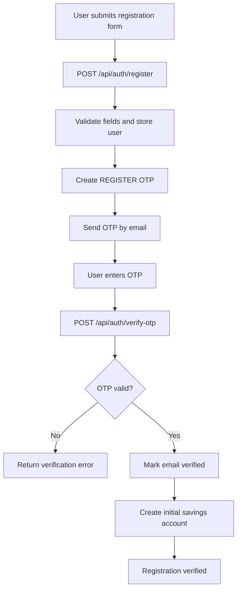
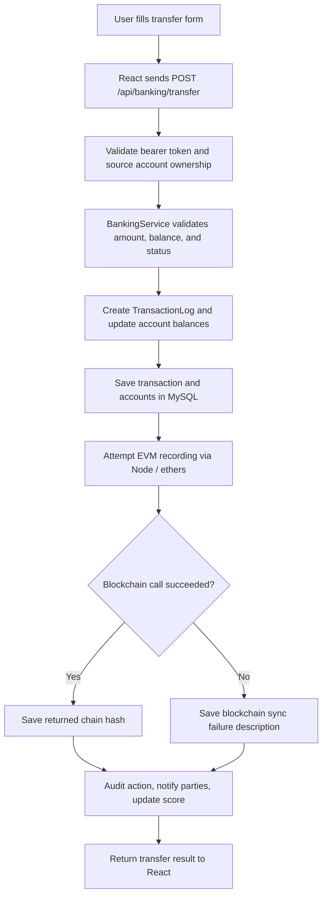
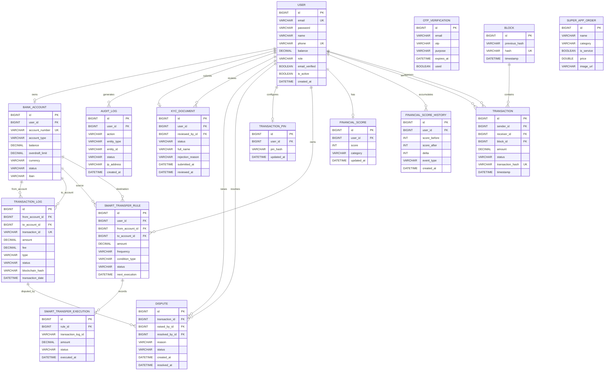

# VAULTCHAIN Project Guide

This guide describes the project as it exists in this repository: a React banking and administration UI, a Spring Boot REST API backed by MySQL, and a Hardhat-managed EVM integration. It distinguishes implemented code paths from concepts that appear in older project documents.

## 1. Project At A Glance

VAULTCHAIN is a web application for user authentication, account and transaction workflows, KYC, scheduled transfers, financial-score history, administration, and blockchain transaction records. The backend is the system of record for users, balances, and banking transactions. Blockchain recording is an additional integration, not a replacement for the MySQL banking ledger.

### Main capabilities

- Register and authenticate with email/password or email OTP; Google OAuth2 support is configured in Spring Security.
- Manage a bank account and perform transfers and deposits.
- Review transaction history and blockchain records.
- Submit KYC information and provide administrative review screens.
- Create scheduled/conditional smart-transfer rules and inspect their execution history.
- Review suspicious-activity alerts generated by deterministic account, login, and transaction rules.
- View financial scores, security settings, and audit/monitoring screens.
- Browse a Super App storefront UI and governance-related UI/contracts.

## 2. Languages And Technologies

| Area | Language / technology | Role |
|---|---|---|
| Web client | JavaScript, JSX, HTML, CSS | React pages, client routing, API requests, presentation |
| Frontend build | Vite, npm | Development server and production bundling |
| UI | React 19, React Router, Tailwind CSS, Lucide React, Framer Motion, Recharts | Screens, navigation, styles, icons, animation, charts |
| API | Java 17, Spring Boot 4, Spring MVC | REST controllers, application/business services |
| Persistence | Spring Data JPA / Hibernate, MySQL 8 | Entity persistence and relational storage |
| Authentication | Spring Security, JWT, OAuth2 client, JavaMailSender | Password/OTP auth, bearer tokens, Google OAuth, email |
| Blockchain | Solidity 0.8.24, Hardhat, Node.js, ethers.js | Smart contracts, local EVM, transaction recording scripts |
| Operations | PowerShell, bash, and native local scripts | Native local execution and service startup support |

## 3. Architecture



### Responsibility boundaries

- **React client:** route selection, forms, screen state, API calls, client-side token attachment, and role-based presentation guards. Client route guards improve navigation but are not a substitute for server-side authorization.
- **Spring Boot API:** request validation, JWT checks, business rules, account balance changes, transaction/audit records, email notifications, and integrations.
- **MySQL:** durable application records. Hibernate is configured to update the schema from JPA entities at startup (`ddl-auto=update`).
- **EVM:** optional transaction-recording destination for banking operations. `BlockchainService` invokes a Node script in `blockchain/` and submits `BankLedger.recordTransaction` through ethers.js.
- **Email/OAuth providers:** external services used for verification codes, notifications, and Google authorization.

## 4. Main User Flows

### Registration and OTP verification



Login OTP verification returns a JWT for successful authentication. The frontend stores the token in `localStorage`; `src/api.js` adds it as an `Authorization: Bearer ...` header on API requests. Password login, forgotten-password OTP, and OAuth2 are additional paths.

### Banking transfer



The code attempts blockchain recording after changing the MySQL records. A blockchain sync failure is caught and recorded; it does not, by itself, reverse the completed database transfer. Do not treat the MySQL transaction and an EVM transaction as one atomic distributed transaction.

### Smart transfer

1. The user creates a rule with source/destination accounts, amount, frequency, and optional condition.
2. The backend stores a `SmartTransferRule` and calculates its next execution time.
3. The scheduled worker finds due active rules and evaluates supported conditions.
4. Eligible rules call the same `BankingService.transferMoney` operation as manual transfers.
5. A `SmartTransferExecution` records the result; successful/failed outcomes can update score history and trigger an email.

### Fraud and suspicious-activity monitoring

The admin suspicious-activity screen reads `/api/admin/suspicious-activity`. The backend currently raises rule-based alerts for:

- Users with at least three failed login attempts, a locked account, or an inactive account.
- Transactions over 50,000 (in the application's configured amount units).
- Transactions whose status is `FAILED`.
- Audit events marked as failures, login failures, account locks, or account blocks in security monitoring.

The admin can inspect an associated user and block that account. These are deterministic heuristics and audit filters; the repository does not currently show a trained AI/ML model, inference service, or AI-provider integration. The UI's “Fraud & Risk Engine” label should therefore be understood as product wording, not evidence of AI-based detection.

### Signatures and transaction confirmation

There are several security mechanisms, but they serve different purposes:

- **JWT integrity:** `JwtUtil` signs authentication tokens with HMAC-SHA256 (HS256). This is token signing, not a user's digital signature on a document or payment authorization.
- **EVM transaction signing:** `blockchain/scripts/recordTransaction.js` creates an ethers.js wallet from the configured backend private key and uses it to sign and submit `BankLedger.recordTransaction` calls. This is the backend's blockchain account signing an EVM transaction, not the banking user signing the underlying transfer.
- **Transfer PIN and OTP:** the transaction PIN is BCrypt-hashed; the security API also supports transfer OTP verification. These are authorization checks, not cryptographic digital signatures.
- **Document signatures:** no user-facing document-signing, certificate/PKI, signature capture, or signature-verification workflow was found in the current source.

## 5. Frontend Modules And Routes

`src/App.jsx` owns the route table and separates public, authenticated-user, and admin screens.

| Route group | Main pages | Responsibility |
|---|---|---|
| Public/auth | `/`, `/login`, `/signup`, `/otp`, `/forgot-password`, `/oauth2-success` | Login, registration, OTP, password recovery, OAuth return |
| Banking | `/dashboard`, `/banking`, `/transfer`, `/deposit`, `/withdraw`, `/transactions` | Overview, accounts, money movement, transaction history |
| User/security | `/profile`, `/kyc`, `/security`, `/financial-score` | Profile, compliance submission, security options, score |
| Blockchain/automation | `/blockchain`, `/smart-transfers` | Ledger exploration and scheduled transfer rules |
| Super App | `src/pages/SuperApp.jsx` | Storefront-style application area |
| Admin | `/admin/dashboard`, `/admin/users`, `/admin/users/:id`, `/admin/kyc`, `/admin/transactions`, `/admin/security`, `/admin/blockchain`, `/admin/suspicious-activity`, `/admin/audit-logs`, `/admin/admin-management`, `/admin/settings` | User, KYC, transaction, security, and system administration |

Shared navigation is implemented in `src/components/Sidebar.jsx` and `src/components/AdminSidebar.jsx`. The admin route guard checks for `ROLE_ADMIN` or `ROLE_SUPER_ADMIN` in browser storage; protected API operations still need corresponding backend authorization.

## 6. Backend Modules

| Package / representative classes | Responsibility |
|---|---|
| `controller/` | REST entry points: auth, banking, admin, KYC, financial score, smart transfers, transaction security, governance, payment, and catalog/item functions |
| `service/` | Business operations: banking, OTP/email, JWT, audit, KYC, encryption, financial score, smart transfers, governance, and blockchain bridge |
| `model/` | JPA entities mapped to relational tables |
| `repository/` | Spring Data JPA database access for users, accounts, transactions, KYC, audit, scores, smart transfers, blocks, and related records |
| `config/` | Security/JWT filtering and blockchain-related application configuration |
| `src/main/resources/application.properties` | Runtime settings for server, mail, OAuth2, MySQL, blockchain, and JWT |

The main banking endpoint family is `/api/banking`; authentication is `/api/auth`; smart transfers are `/api/smart-transfers`; governance vote handling is `/api/governance/vote`. For exact request/response shapes, compare the current controllers with [API.md](API.md), since that document may not enumerate every current endpoint.

## 7. Database ER Diagram

This diagram follows the JPA entity mappings. `TransactionLog` and `Transaction` are intentionally shown as separate models: the banking service uses `TransactionLog`; `Transaction` belongs to the block-oriented ledger model.



### Data-model notes

- `BankAccount.user` is declared `@OneToOne`, not `@OneToMany`. Although account endpoints return lists, the current entity mapping represents one account per user. Supporting multiple accounts per user requires changing that mapping and reviewing account creation constraints.
- `OtpVerification` stores an email string, purpose, expiry, and used flag; it has no JPA relationship to `User`.
- `SmartTransferExecution.transactionLogId` is a string reference to a transaction identifier, not a JPA foreign key.
- `SuperAppOrder` is a catalog-like entity in the current model; it does not declare an owner, line items, or a payment/transaction relationship.
- `Transaction` plus `Block` is a second relational ledger model. It is not the same persistence path as banking `TransactionLog` plus the `BankLedger` EVM contract.

## 8. API Surface (High Level)

| Base path | Main operations |
|---|---|
| `/api/auth` | Register, password login, request/verify OTP, forgot/reset password |
| `/api/banking` | Create/list accounts, recipient lookup, balance, transfer, deposit, transaction history, KYC/AML-related banking functions |
| `/api/smart-transfers` | Create/list/update/delete/pause/resume rules; inspect executions |
| `/api/kyc` | Submit and inspect user KYC information; administrative verification functions are under admin routes |
| `/api/financial-score` | Read score and score-history data |
| `/api/admin` | Administrative summaries and operations |
| `/api/governance` | Submit a vote request |
| Other controllers | Payment, item/catalog, and transaction-security operations |

The shared Axios client uses `VITE_API_URL`, falling back to `http://localhost:8080`. It attaches the locally stored bearer token and clears local authentication values after a non-auth API request returns HTTP 401.

## 9. Repository Map

```text
src/                         React app, API client, styles, pages, components
backend/src/main/java/       Spring Boot controllers, services, models, repositories, config
backend/src/main/resources/  Backend runtime configuration
backend/src/test/java/       Backend tests
blockchain/contracts/        Solidity contracts
blockchain/scripts/          Contract deployment and transaction-recording scripts
backend_templates/           Configuration template(s); use these instead of committing credentials
commands/                    Development helper scripts
public/                      Static frontend assets
```

Useful existing references: [README.md](README.md), [SETUP.md](SETUP.md), [API.md](API.md), [DEPLOYMENT.md](DEPLOYMENT.md), and [TROUBLESHOOTING.md](TROUBLESHOOTING.md).

## 10. Local Development Topology

The project has three independently runnable processes. MySQL must also be available unless the configured database is changed.

```powershell
# Backend API (from the repository root)
cd backend
./mvnw.cmd spring-boot:run
```

```powershell
# Frontend (from the repository root, in another terminal)
npm install
npm run dev
```

```powershell
# Optional local EVM (from the repository root, in another terminal)
cd blockchain
npm install
npm run node
```

For EVM transaction recording, deploy the contract to the local node and configure the backend RPC URL, contract address, and signer private key. Use [SETUP.md](SETUP.md) for the repository's complete setup steps and any environment-specific requirements.

## 11. Important Verification And Security Notes

- Runtime configuration currently contains sensitive-looking mail/OAuth values and fallback database/JWT settings in `application.properties`. Treat credentials as exposed: rotate/revoke real secrets, move them into environment variables or a secret store, and keep only placeholders in committed configuration. This guide intentionally does not copy any values.
- The React route guards read role/token values from browser storage. Enforce permissions at the API boundary; a browser-side role check is not a security boundary.
- Fraud alerts are based on explicit thresholds and audit states, not an AI/ML classifier. Thresholds should be configured and reviewed for the intended currency, risk policy, false-positive rate, and audit requirements.
- The configured EVM private key signs backend contract calls. It is not an end-user signing key; production use should keep it in a managed secret/key service and restrict its permissions.
- The banking controller performs explicit JWT/account-owner checks on key operations, but each endpoint must be reviewed individually before describing the entire API as protected.
- Blockchain availability is separate from MySQL availability. A transfer may complete in the application database even when the EVM call fails, with failure detail recorded on the transaction log.
- Some repository documents describe behavior or fee/security details that may differ from current code. When they conflict, use the current controller, service, entity, and configuration as the source of truth.
- The governance Solidity contract exists in `blockchain/contracts/SovereignGovernance.sol`; do not assume the governance API is writing to that contract without verifying its service implementation and deployment configuration.
